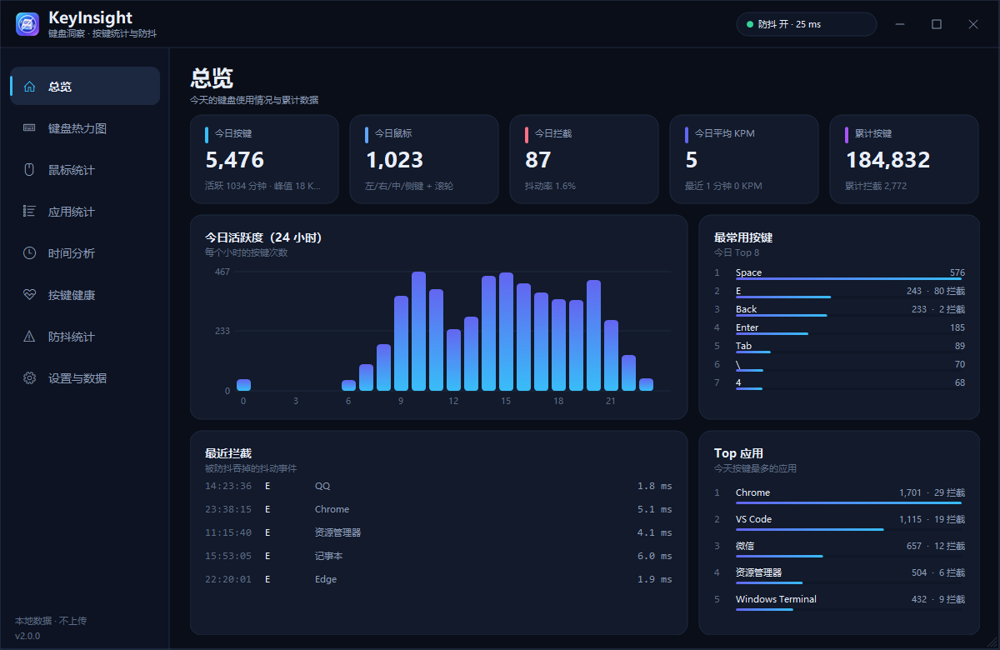
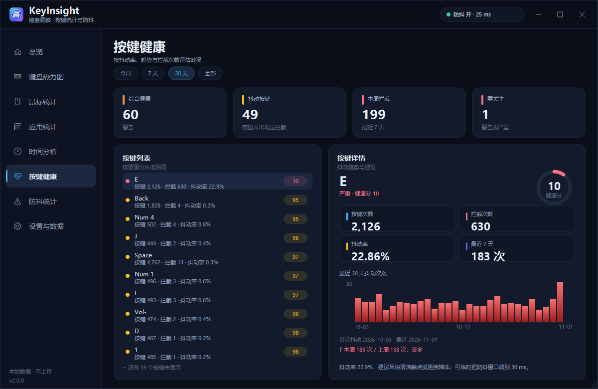
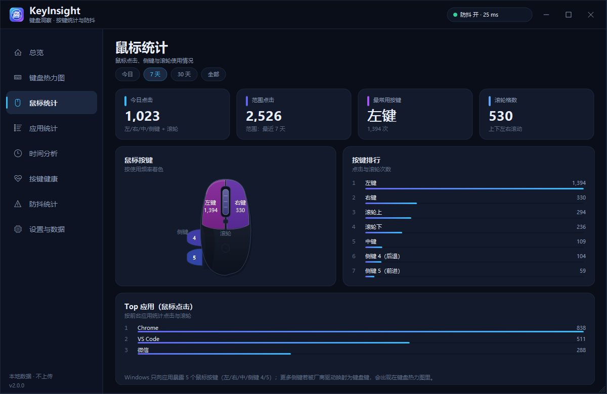
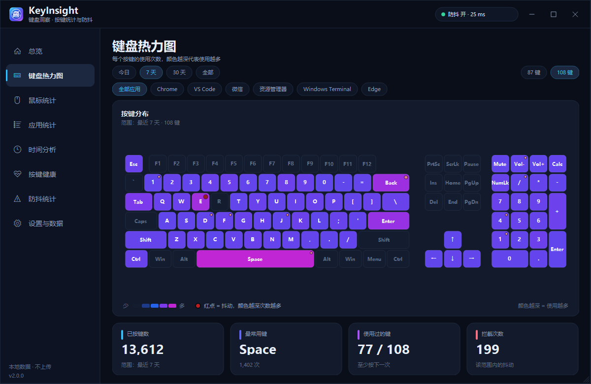
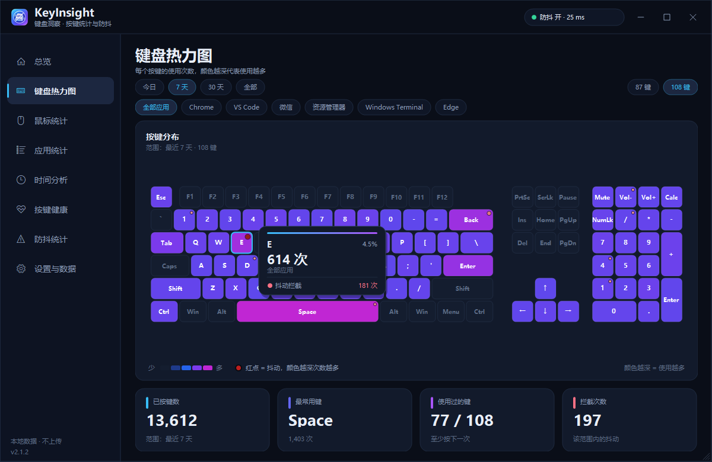

# KeyInsight 键盘洞察

[](https://github.com/CZM1998/KeyInsight/actions/workflows/build.yml)
[](https://github.com/CZM1998/KeyInsight/actions/workflows/release.yml)
[](LICENSE)

一个 Windows 键盘 / 鼠标使用统计与按键防抖工具。最初是为了解决前行者 X87S 键盘 `E` 键触点抖动（按一下出两个 `e`）而写的，后来扩展成了带按键热力图、鼠标统计、按键健康度和防抖诊断的桌面面板。

所有数据只保存在本机，不记录输入内容、窗口标题或鼠标轨迹。



## 功能

- **按键防抖**：全局低级键盘钩子，双窗口（按下间隔 25 ms + 松开后 40 ms）吞掉同键重复按下。
- **键盘热力图**：87 键 TKL / 108 键全尺寸（含数字小键盘）切换；颜色越深使用越多；抖动键右上角显示红点，拦截次数越多颜色越深。
- **按键健康**：综合健康分、每个抖动键的抖动率、本周/上周趋势、首次/最近抖动日期、30 天抖动柱状图，以及清洁/换轴建议。
- **鼠标统计**：左/右/中键、侧键 4/5、滚轮上下左右；鼠标示意图按频率着色，含按键排行和按应用排行。
- **使用时间分析**：24 小时分布、星期 × 小时热力、最近 30 天趋势。
- **应用统计**：按前台进程分组，只记录进程名，不记录窗口标题；支持 Top 键盘、Top 应用。
- **防抖统计**：拦截总数、抖动率、按键/应用排行、实时拦截流、窗口大小切换。
- **界面**：自绘深/浅色主题，跟随 Windows；窗口可拖动、缩放、最大化；键盘悬停使用自绘圆角卡片（次数/占比/抖动/应用），不再使用系统 Tooltip。
- **趣味换算**：滚轮距离换算成楼层/操场/埃菲尔铁塔/珠峰；点击次数换算成连点分钟；侧键次数；累计按键换算成 10 万字小说。
- **检查更新**：托盘菜单和设置页都能手动检查；启动后每 24 小时自动检查一次。
- **数据管理**：按月保存、永久保留；按月删除、清空全部、导出 4 个 CSV；启动时自动检查 GitHub 更新。
- **托盘**：双击打开面板；菜单可切换防抖、开机自启、检查更新、重新安装输入钩子、退出；关闭按钮只隐藏到托盘。

| 按键健康 | 鼠标统计 |
|---|---|
|  |  |

| 键盘热力图 | 键盘悬停提示 |
|---|---|
|  |  |

## 下载与安装

从 [Releases](https://github.com/CZM1998/KeyInsight/releases) 下载：

- `KeyInsight-Setup-x.y.z.exe`：推荐，按用户安装到 `%LOCALAPPDATA%\Programs\KeyInsight`，不需要管理员权限；
- `KeyInsight-x.y.z-portable.zip`：便携版，解压后直接运行 `KeyInsight.exe`；
- `sha256.txt`：安装包和便携包的 SHA256。

要求：Windows 10/11（64 位），系统自带 .NET Framework 4.8。

> 当前 exe/安装包没有代码签名，Windows SmartScreen 可能提示“未知发布者”。源码公开在仓库里，可自行审阅或从源码构建。

## 使用

1. 启动 `KeyInsight.exe`，托盘出现图标（可能在任务栏溢出区 `^` 里）。
2. 双击托盘图标打开面板；右键托盘可以开关防抖、开机自启、检查更新、重新安装输入钩子。
3. 面板页面：总览、键盘热力图、鼠标统计、应用统计、时间分析、按键健康、防抖统计、设置与数据。
4. 关闭面板只是隐藏到托盘；退出请用托盘菜单的“退出”。
5. 想长期使用：设置与数据 → 开启开机自启（写入 `HKCU\...\Run`）。

## 按键健康

- 抖动率 = `拦截 / (按键 + 拦截)`。
- 健康分：`100 - min(90, 抖动率×400 + 本周拦截×1.2)`；分数越高越健康。
- 状态：≥90 观察、≥60 警告、<60 严重（出现抖动即至少“观察”）。
- 综合健康分 = 按按键次数加权的平均分 × 0.6 + 最差键分数 × 0.4，避免被大量健康键“稀释”。
- 每个键有 30 天抖动柱状图、本周 vs 上周趋势、首次/最近抖动日期和建议。
- 红点来自实际被防抖吞掉的重复按下，不是估算。

## 趣味换算

- 鼠标滚轮：按「1 格 ≈ 3 cm」估算（约 3 行 × 1 cm），显示范围累计距离，并按距离给出楼层、400 米操场、埃菲尔铁塔、珠峰等参照。
- 鼠标点击：按「每秒 2 次」估算连续点击需要多少分钟。
- 侧键 4/5：换算成网页前进/后退次数。
- 累计按键：按「每键 1 字符、10 万字/本」估算相当于写完多少本小说。
- 这些只是趣味估算，不代表精确的物理距离或输入内容。

## 数据与隐私

- 只记录：虚拟键码、按键次数、时间（日期/小时/分钟）、前台进程文件名、拦截次数、鼠标按键编号与滚轮格数。
- **不记录**：输入内容、窗口标题、鼠标坐标/移动轨迹、剪贴板、网络数据。
- 数据目录：`KeyInsight\data\`（便携版在 exe 旁边；安装版在安装目录）；`KeyInsight.ini` 为配置。
- 每月一个 `YYYY-MM.kds` 文本文件，Tab 分隔：`D` 每日汇总、`M` 活跃分钟位图、`K` 按键、`A` 应用、`AK` 应用×按键、`MB` 鼠标、`AMB` 应用×鼠标。
- 面板自己的输入（进程名 `keyinsight`）会被跳过。
- 数据完全在本机；卸载不会自动删除数据，需要手动清理。

## 自动更新

- 每次启动后（最多每 24 小时一次）请求 GitHub Releases API 的最新版本。
- 托盘菜单「检查更新」和设置页「关于与隐私 → 检查更新」都可以手动触发。
- 发现新版本时托盘气泡提示；点击气泡或手动检查后下载 `KeyInsight-Setup-*.exe`。
- 下载后会校验 `sha256.txt`，通过后弹出确认，运行 Inno Setup 静默安装并重启。
- 安装版（`%LOCALAPPDATA%\Programs\KeyInsight`）可直接自动更新；便携版会被安装到用户目录，建议在 `KeyInsight.ini` 里设 `AutoCheckUpdates=0`，或继续使用便携包。
- 自动更新默认开启，可在 `KeyInsight.ini` 中关闭：`AutoCheckUpdates=0`。

## 从源码构建

需要 Windows 自带的 .NET Framework 4.8 和 `csc.exe`，不依赖 NuGet。

```powershell
# 普通构建（版本 2.2.0）
powershell -ExecutionPolicy Bypass -File tools\build.ps1 -Version 2.2.0

# 核心/存储测试（独立测试 exe，不参与主程序打包）
powershell -ExecutionPolicy Bypass -File tools\test.ps1 -Suite All

# 自检
.\KeyInsight.exe --selftest
Get-Content selftest.log

# 生成深/浅色页面截图
.\KeyInsight.exe --screenshot shots

# 可选：把便携数据迁移到安装目录布局（%LOCALAPPDATA%\KeyInsight，含备份清单与哈希校验）
.\KeyInsight.exe --migrate-data
```

`tools\build.ps1` 会生成 `VersionInfo.cs` 并把版本写入 exe；`Assets\app.ico` 和 `app256.png` 由 `tools\make-icon.ps1` 从 `Assets\icon-source.png` 生成。

### 目录结构（v2.2+）

```text
Core/       纯逻辑层（键身份、策略引擎、状态机、遥测队列、异步日志）
Stats/      KDS1 存储、聚合、侧车（用量/诊断/快捷键）、迁移与周报
Tests/      独立测试（Core/Storage/Telemetry 套件；build.ps1 自动排除）
data/       KDS1 月份文件（格式冻结）；data/v2、data/diagnostics 为新增侧车
```

测试基线：78 项确定性测试（黄金轨迹、KSM-001~020、LEG-001 差分、KDS1/CSV 快照、TEL/STO 系列）。
重新基线化 CSV 快照：设置环境变量 `KI_UPDATE_GOLDEN=1` 运行 `tools\test.ps1 -Suite Storage`。

## CI / 自动打包与发布

仓库自带两个 GitHub Actions 工作流：

- `.github/workflows/build.yml`：push / PR 时构建、运行 `--selftest`、上传 exe 产物。
- `.github/workflows/release.yml`：推送 `v*` 标签时自动构建、自检、用 Inno Setup 生成安装包、打便携 zip、生成 SHA256，并发布到 GitHub Release。

发布新版本：

```bash
git tag v2.1.2
git push origin v2.1.2
```

几分钟后 Releases 页面会出现：

- `KeyInsight-Setup-2.1.2.exe`
- `KeyInsight-2.1.2-portable.zip`
- `sha256.txt`

自动更新读取的就是这些资产。

## 限制

- 低级键盘/鼠标钩子拿不到设备来源，防抖和统计是全局的（所有键盘、所有鼠标合并计数）。
- Windows 只向应用暴露 5 个鼠标按键（左/右/中/侧键 4/5）和滚轮；更多侧键通常被厂商驱动映射成键盘按键，会显示在键盘热力图里。
- NumLock 关闭时，小键盘 Home/End/PgUp/PgDn/方向键与主键区发送相同虚拟键码，会合并统计；小键盘 Enter 已通过扩展扫描码与主 Enter 分开。
- 对以管理员权限运行的程序，普通权限钩子可能收不到按键；需要时以管理员身份运行。
- 便携版自动更新会转为安装版；如需保持便携，请关闭 `AutoCheckUpdates`。
- 未签名 exe，部分杀毒软件可能误报。

## 路线图

- 按键级自适应防抖窗口 + 调参向导（根据实际 near-miss 间隔自动建议）
- 鼠标侧键映射（把厂商驱动映射的键盘键归到侧键槽位）
- 更多配列：75%、96%、Alice
- 应用图标、图表 hover、周报/月报
- 代码签名与更完善的更新通道

## 贡献

欢迎 Issue / PR。提交前请先跑 `tools\build.ps1` 和 `KeyInsight.exe --selftest`。

请勿在 Issue 或 PR 中粘贴密码、Token 或任何个人数据；本项目不需要也不接受账号凭据。

## License

[MIT](LICENSE) © 2026 CZM1998
